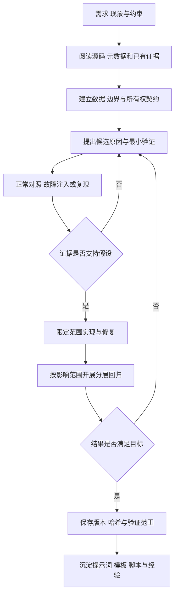

# 大模型协作记录与技能包提炼过程

本记录说明SGM与LDS-Net道路感知系统中，大模型如何参与问题分析、实现、纠错与验证，以及项目经验如何提炼为可复用的PYNQ技能包。系统设计及复现步骤见[设计报告](design_report.md)，工具见[skill](../skill/README.md)。

**记录性质：以下提示词、模型回答和反馈依据项目技术文档、协作材料及工程证据重构，用于呈现协作方法，不是原始聊天逐字稿。“初步建议”表示需要验证的候选方案，不能单凭文字判断其正确。历史验证结果保留原有版本和场景范围，不作为当前改名源码重新执行RTL或板测的结果。**

## 1 协作目标与分工

本项目需要在Zynq-7020上连接真实摄像头、四路径SGM、LDS-Net整数网络、DDR和HDMI。协作难点不仅是单个算法能否输出结果，还包括输入是否能持续接收、边界是否正确、数据是否属于完整帧、缓冲是否仍被硬件访问，以及源码是否确实进入运行位流。

| 环节 | 团队提供与确认 | 大模型辅助工作 | 需要形成的成果 |
|---|---|---|---|
| 需求定义 | 板卡、资源、功能、不能改变的算法与接口 | 将描述转成可检查的条件 | 接口契约、范围与验收项 |
| 故障分析 | 画面、报错、寄存器、日志和波形 | 阅读Python/Verilog/Tcl，提出原因与最小验证 | 证据、候选原因及排查顺序 |
| 实现与纠错 | 审核影响范围，反馈实际行为 | 修改限定模块，补充正常及故障用例 | 变更说明、测试与结果 |
| 验证与交付 | 必要的真实设备操作及最终判断 | 汇总算法、RTL、实现和接口证据 | 版本、哈希及验证边界 |

团队负责实际目标和验收判断，大模型提供可核验的分析与实现建议。生成代码需要经过独立参考或测试核对；软件模型、RTL仿真和实际板测分别记录。

## 2 典型协作案例

### 2.1 实时采集无法提交完整视差帧

**现象。** 历史四路径SGM版本中，RGB可以更新，SGM却不能提交新的完整视差帧，普通逐像素仿真没有复现故障。

**提示词示例，重构。**

> 请检查双摄像头到SGM、DDR和HDMI的数据路径。RGB有画面，但视差分支没有新的完整帧。区分初始化、反压、输入丢帧和DDR提交问题，给出能够复现故障的测试。保留摄像头配置与SGM算法参数。

**模型初步回答，重构。**

> 可能是处理延迟增加或等待不足，可先扩大等待窗口，并检查视差DMA状态。

**反馈与自我纠错。** 延长等待不能恢复已经丢失的像素。原仿真源会等待TREADY，真实摄像头却不能随计算支路停顿，因此“仿真通过”的前提与实物输入不同。模型据此将分析重点转到生产广播器、支路服务率及丢帧策略。

**修正回答，重构。**

> 建立不等待SGM TREADY的连续采集源，保留真实桥接和缓冲逻辑。按成功握手计数，检查慢支路是否丢弃剩余帧。长期服务率不足时需要调整计算组织或明确丢帧策略；有限缓存只能吸收有限突发。

**形成的方法。** 协作资料记录，2026年10月10日的指定历史版本对两张640×480图、合计614,400个视差像素完成整链路参考比对，在该仿真场景下零像素差异、SGM支路零丢帧。该结果不能推广成当前所有输入速率和物理板卡场景都已验证。

**可迁移结论。** 同时验证可接受反压的标准流源，以及不可暂停的物理源及其桥接逻辑。当前相关源码为[采集广播](../src/sgm_yolo/hardware/rtl/sgm/axis_video_broadcast2.v)和[SGM模块](../src/sgm_yolo/hardware/rtl/sgm/)；通用验证方法见[协议说明](../skill/references/protocol.md)。

### 2.2 将TLAST误当作整帧完成

**提示词示例，重构。**

> 分析存在输出反压的AXI4-Stream波形，检查TVALID、TREADY、TDATA、TKEEP、TLAST及TUSER是否存在丢拍、重复拍或边界错位。注意视频流、通用包及自定义DMA的差别。

**模型初步回答，重构。**

> 先检查TLAST是否出现在最后一个像素，并以此判断帧完成。

**反馈与自我纠错。** TLAST有效但未被握手接收，不构成已完成的边界传输；视频TLAST通常表示行结束。仅按TVALID周期数计数，还会把阻塞中的同一拍多算。模型因此补充了模式契约、接受拍与边带保持条件。

**修正回答，重构。**

> 先确认接口模式和边界含义。只有TVALID与TREADY同时有效的采样边沿才计入传输。阻塞期间有效载荷及适用边带保持到接收。视频分别检查TUSER[0]帧起点与TLAST行结束，通用包按包长和尾拍规则检查。

**形成的方法。** Skill将packet与video配置分开，检查阻塞稳定性、包长、尾拍TKEEP及行帧边界；半途开始、截断或稀疏捕获保留“证据不足”。接受字节可进一步与独立参考比较，避免将协议合法等同于算法正确。

**源码落点。** [接口配置](../skill/references/contracts.md)、[核心检查器](../skill/scripts/axis_core.py)、[SV检查模板](../skill/assets/axis_checker.sv)。

### 2.3 读取DDR时缺少完整帧与所有权保护

**提示词示例，重构。**

> LDS-Net检测框需要结合SGM视差生成俯视目标。PS读取时缓冲可能被覆盖，最后一个像素输出也未必意味着DDR写入完成。请检查完整帧、坐标转换、错误响应、取消和超时条件。

**模型初步回答，重构。**

> 检测结束后读取当前视差缓冲，执行缓存失效，再按框中心取样。

**反馈与自我纠错。** 缓存失效只能保证CPU读到可见数据，不能避免并发覆盖；原始检测中心与校正视差坐标也不同。最后输入拍被接受后仍可能存在在途内存写响应。模型随后将传输、内存完成、发布与释放区分开来。

**修正回答，重构。**

> 请求携带token，等待请求后的有效帧起点，只有完整写入且成功写响应返回后才发布。采样期间保留缓冲所有权，前后核对token和帧序号。先做原图到校正坐标的转换；异常后确认硬件访问停止，再处理内存回收。

**形成的方法。** SNP1请求、帧序号及释放协议管理完整视差帧；采样线程保留租约，停止时等待访问者排空。仍需注意：快照对应下一完整SGM输出帧，不能自动等同于检测曝光帧。

**源码落点。** [快照租约](../src/sgm_yolo/dual_ov5640/sgm_snapshot.py)、[视差DMA](../src/sgm_yolo/hardware/rtl/sgm/sgm_disparity_dma.v)、[几何变换](../src/sgm_yolo/dual_ov5640/bev_geometry.py)、[结果提交](../src/sgm_yolo/dual_ov5640/result_commit.py)及[相关回归](../src/sgm_yolo/tests/test_bev_depth.py)。

### 2.4 源码中的接口没有进入实际位流

**提示词示例，重构。**

> Python和RTL已经包含SNP1，但真实能力寄存器不符合预期。请沿源码、HWH、综合缓存、最终网表、bit和驱动检查对应关系。

**模型初步回答，重构。**

> 先核对寄存器偏移与MMIO地址，再重新加载配套文件。

**反馈与自我纠错。** 源码和地址正确，不能证明新逻辑进入运行硬件。协作资料记录过视差DMA的module_ref缓存未刷新，造成源码/HWH说明与实际位流能力不一致。模型因此增加了依赖闭包和实际网表的核验步骤。

**修正回答，重构。**

> 对同一构建检查源码依赖、缓存DCP、综合采用模块、最终网表、bit/HWH与驱动。缓存失效依据覆盖递归RTL依赖内容哈希；启动时读取真实能力值，不能仅相信文件名或HWH中的说明。

**形成的方法。** 使用内容哈希判断module_ref缓存归属，在启动前核验能力。`0xF0`与`0x534e5031`属于本项目SNP1接口，通用工具提炼“能力和制品一致性核验”，不要求其他工程采用同一寄存器值。

**源码落点。** [依赖哈希管理](../src/sgm_yolo/tools/lds_net_ooc_sources.py)、[启动与能力检查](../src/sgm_yolo/dual_ov5640/overlay.py)、[硬件契约](../src/sgm_yolo/dual_ov5640/hardware_contract.py)。这些入口不意味着通用Skill已经实现全部项目专用DCP审计。

### 2.5 有检测提示但俯视目标没有更新

**提示词示例，重构。**

> 行人提示仍能触发，但俯视目标没有更新。按检测结果、视差采样、道路处理、描述符提交和UI确认排查，保留模型、阈值与颜色规则。

**模型初步回答，重构。**

> 先检查UI描述符、DDR缓存同步与跨时钟提交是否阻塞。

**反馈与自我纠错。** 报错包含`pad() missing 1 required positional argument: mode`，俯视更新为零，而UI没有读取或缺行错误。模型据此定位到提交前的PS语义区域处理，异常后的清空行为解释了“存在检测而目标不显示”。

**修正回答，重构。**

> 用要求显式mode的函数签名建立最小复现，仅补齐常量零填充参数，保持算法、阈值与掩膜不变。再运行开启HUD的PS工作线程路径，检查目标提交与UI帧确认。

**形成的方法。** 修复显式传入`mode='constant', constant_values=0`。协作资料中的该历史专项包含两项针对性验证及当时51项软件回归，不是物理板卡重新测试；当前源码回归集合与当时不同，不能将数量直接相加。

**源码落点。** [道路连通区域](../src/sgm_yolo/dual_ov5640/alerts.py)、[兼容性回归](../src/sgm_yolo/tests/test_bev_numpy_compat.py)、[UI回归](../src/sgm_yolo/tests/test_ps_ui.py)。该案例提炼的是依据异常最小复现、限定修改范围的方法，具体NumPy补丁不属于AXI协议规则。

## 3 协作工作流与结论检查



此图描述任务组织方式，不表示项目已经建成无人值守自动发布系统。每轮先判断已有证据是否覆盖当前源码，再决定是否重跑；不满足前提时保留未知项。真实设备操作、恢复和最终验收由团队根据现场条件确认。

性能与结论检查遵循以下口径：

- 区分处理吞吐、单帧延迟、显示刷新率和端到端推理帧率。
- 区分算法参考、接口模型、RTL仿真、综合、实现和板端测量。
- 局部模块的时序通过不能证明全系统通过；不同频率与不同源码不能共用结论。
- 资源与时序同时检查，不能仅由正setup slack推断hold、周期、脉宽及CDC均满足。
- 设计目标、理论上限和缺少的测量不能写成已经取得的实测值。

## 4 从项目经验提炼通用技能

### 4.1 提炼对象

直接复制整个视觉系统会把算法、板卡和固定寄存器一起带给使用者。项目将共性问题收敛为“PYNQ AXI4-Stream链路验证、故障诊断与性能分析”，以接口契约、握手、DMA、参考数据和证据处理作为复用单元。

| 原始失败或观察 | 提炼规则 | 工具或模板 | 适用与失效边界 |
|---|---|---|---|
| 可暂停测试源通过，真实采集慢支路缺帧 | 显式建模物理源与服务率，不只测标准反压 | [协议说明](../skill/references/protocol.md)、[提示词](../skill/references/prompts.md) | 源速率、桥接及丢帧策略来自目标工程，通用规则不能替代设备模型 |
| 反压下重复计数或边带变化 | 按成功握手计数，检查待接收拍稳定性 | [核心脚本](../skill/scripts/axis_core.py)、[SV检查器](../skill/assets/axis_checker.sv) | 当前检查子集面向单时钟、非交织流 |
| 包和视频TLAST含义混用 | 先填写包/视频契约，再检查边界 | [packet配置](../skill/assets/packet.json)、[video配置](../skill/assets/video.json) | 缺少采样及边界信息时保留证据不足 |
| 数据结束但硬件仍可能访问缓冲 | 分别核验完成、缓存可见性和所有权 | [诊断方法](../skill/references/diagnosis.md)、[板端模板](../skill/assets/board_loopback.py) | 模板只支持约定的AXI DMA Simple，自定义租约另行适配 |
| 新源码不代表运行硬件已经更新 | 对照版本、能力、元数据及制品 | [HWH等检查入口](../skill/scripts/axis_tool.py) | 不硬编码SNP1，也不代替项目专用综合网表审计 |
| 截断或稀疏波形导致错误性能结论 | 区分通过、失败、证据不足 | [性能说明](../skill/references/performance.md) | 没有有效连续时基，不计算不成立的吞吐或跨域延迟 |
| 局部时序和显示流畅被写成整机达标 | 保留原报告和计量范围，分层归档 | [资源采集](../skill/scripts/collect_resources.py)、[报告模板](../skill/assets/report_template.md) | 仿真、估计及局部实现不等于整机板测 |

### 4.2 成果组织

**提示词工作流。** 在[SKILL.md](../skill/SKILL.md)与[prompts.md](../skill/references/prompts.md)中确定先读取什么、如何检查契约与冲突，按“现象—证据—候选原因—验证动作—修复—回归”输出。

**工程与报告模板。** [assets](../skill/assets/)提供配置、SystemVerilog检查器、测试平台、板端回环适配和报告骨架。使用者替换位宽、包长、端口及启动条件，不复制本项目私有接口。

**确定性校验脚本。** [scripts](../skill/scripts/)提供CSV/VCD处理、接受字节提取、黄金字节比对、DMA状态解码、统计及资源报告采集。离线核心使用Python标准库，便于独立复制。

**故障定位方法。** [诊断说明](../skill/references/diagnosis.md)将触发条件、状态、相邻端点证据及排查动作联系起来。NumPy补丁等应用故障保留在协作案例，不把它们扩展成协议规则。

## 5 如何验证提炼结果有效

验证同时检查故障检出和正常行为不被误报：

1. 正常对照覆盖随机反压、尾拍部分字节、连续包和视频边界。
2. 主动注错覆盖阻塞数据变化、撤销TVALID、缺失/提前TLAST、尾拍TKEEP及视频行边界异常。
3. 观测不足对照使用半途开始、截断及稀疏捕获，要求返回相应证据限制。
4. 软件MMIO模型检查接收优先准备、错误与超时取证、缓冲保留及恢复前置条件。
5. 独立目录复制仅带技能源码与模板，排除原项目模块和旧结果，复跑相同离线验证。

协作资料记录，2026年10月24日的离线验证通过37项行为测试，包含100个正常随机反压种子；独立副本的37项测试也通过。合成正常包案例为2包、6次成功握手、20个有效字节。这些数字分别描述软件行为与合成输入，不是物理板卡吞吐指标。

当前仓库保留测试与生成脚本，不附带历史验证输出。使用者可从仓库根目录复跑：

```bash
python -B skill/scripts/selftest.py --workspace .
python -B skill/scripts/check_portability.py --workspace .
```

测试代码见[行为测试](../skill/tests/test_skill.py)，样例由[生成器](../skill/scripts/make_examples.py)产生。结果写入`skill/validation/`，合成样例写入`skill/examples/generated/`；这些生成路径已由Git忽略。

## 6 可复用性与失效边界

接口参数与判断方法分开：位宽、包长、视频尺寸、复位、采样、PYNQ/IP版本及板端地址来自目标项目。核心离线规则不依赖SGM、LDS-Net、摄像头型号或固定显示布局。

板端模板仅面向非Micro、非SG的普通AXI DMA Simple。VDMA、MCDMA、自定义写入器、交织流及多时钟延迟不能未经适配直接套用。单次寄存器或单端波形通常不足以精确归因，缺少参考数据也不能由协议通过推断算法数据正确。

超时不证明硬件已经停止；在MMIO阻塞、所有权不清或恢复条件不足时，应保留现场与缓冲引用。不能通过直接重试、重启解释器或提前释放来冒充已恢复。工具也不自行下载Overlay或替使用者确认真实板卡已处于安全可测状态。

离线自测与独立副本复跑支持“目录级可复用”的结论；物理板卡、不同PYNQ版本及跨板迁移仍需真实设备证据。新的失败应补成带前提的回归案例，并记录配置、输入、源码版本、命令和验证层级。

## 7 使用与维护步骤

1. 阅读[技能README](../skill/README.md)和[接口契约](../skill/references/contracts.md)，选packet或video模式。
2. 先运行正常/故障自测，再接入目标CSV、VCD或寄存器快照。
3. 用接受拍检查协议，用黄金字节检查内容，用前后状态和相邻端点缩小原因。
4. 板端操作前核对真实IP、版本、地址、元数据和独占所有权，按匹配模板适配。
5. 正确性确认后再测性能，保留预热、长度、计时范围及原始样本。
6. 将修复后的故障与合法对照一并保留，避免工具只能检出错误却误报正常行为。

本文依据项目《大模型协作记录与技能包提炼过程》及《道路感知与双目测距系统技术文档》整理，统一采用当前仓库名称LDS-Net，并将源码链接更新为公开目录内可访问的位置。历史大体量日志与原始聊天逐字稿不随该源码仓库分发。
