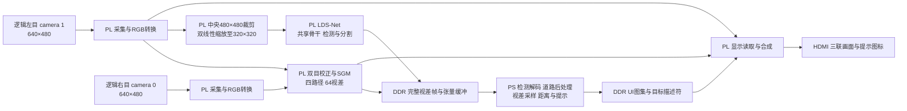

# SGM 与 LDS-Net 道路感知系统设计报告

本项目面向资源受限的道路场景边缘感知，将双目测距、目标检测、可行驶区域分割和可视化集成到 ALINX AX7020 的 Zynq-7020 平台。双 OV5640 提供 640×480 图像，PL 承担四路径、64 视差 SGM 及 LDS-Net 整数网络计算，PS 完成结果解码、局部视差采样、距离换算和提示管理。

LDS-Net 的全称为 Lightweight Detection and Segmentation Network。其共享骨干同时服务检测与道路分割，通过混合 W4A6、非结构化剪枝及整数化部署控制存储和计算开销。已有整数参考评估中，检测 mAP50 为 27.07%、mAP50–95 为 15.55%，白天道路前景 mIoU 为 48.2053%。这些数值描述模型参考精度；实板连续运行、端到端帧率、功耗及测距误差仍需单独验收。

## 1 选题背景与创新点

### 1.1 应用问题

园区巡检、城区配送和低速移动平台需要同时了解“前方是什么”“哪些区域可通行”以及“目标有多远”。检测框提供对象类别和位置，但难以表达连续道路区域；语义分割能够描述通行范围，但不直接提供目标距离；双目视差补充几何深度，仍需要与目标和道路语义关联。

本项目将三类信息放入同一软硬件链路，使使用者能够同时观察原始图像、视差伪彩、俯视目标及道路提示。系统输出可用于辅助感知和工程研究，尚不能由这些功能推断已经完成车辆闭环控制或实际道路安全验证。

### 1.2 相关方法与设计取舍

双目链路采用 Census 局部变换、汉明匹配代价和半全局匹配路径聚合，在固定视差范围内生成视差。神经网络链路采用共享特征的检测与分割结构，并结合整数量化和剪枝。SGM、整数推理、剪枝及多任务学习均有既有研究基础，本项目的设计重点是将这些方法组织成适合 XC7Z020 资源与接口条件的完整系统。

若分别部署检测和分割网络，需要重复提取特征；若将所有感知与图像处理放在 PS 上，处理器还需承担大量像素和卷积运算。项目选择在 PL 执行规则、重复且数据量大的运算，在 PS 实现控制与少量结果处理，使两者围绕明确的张量和帧接口协同。

### 1.3 主要设计特点

1. **共享骨干的双任务网络。** 使用普通卷积、ReLU、残差及 Add 融合，P4/P5 负责检测，P2/P3/F4 特征及 40×40 语义残差补充分割细节和上下文。部署图包含 37 个卷积、8 个 Add 和 3 次最近邻上采样。
2. **精度约束下的低位部署。** 多数层采用 W4A6，首层及五个末端卷积保留 8 位权重；四个卷积进行渐进单连接剪枝，保持通道数、张量尺寸及网络拓扑。
3. **面向受限器件的计算复用。** 网络使用固定通道双打包 DSP 累加、窗口预取及上采样融合；SGM 使用两组 16 通道运算器分时维护四方向状态，在保留四路径、64 视差的条件下组织计算。
4. **显式的结果所有权。** 通过完整帧发布、DDR 缓冲区管理和 SNP1 令牌租约约束视差读取，区分流传输结束、内存写入完成、结果发布及消费者释放。

## 2 系统原理与功能框图

### 2.1 总体结构

硬件平台由 AX7020 主板、AN5642 双目摄像头子板和 HDMI 显示设备组成。核心器件为 XC7Z020，两颗 OV5640 提供双目图像。逻辑左目对应物理 camera 1，逻辑右目对应物理 camera 0。



检测与道路分割共享同一次网络输入及特征提取。视差采样采用请求之后的下一完整 SGM 输出帧，不能自动视为与检测图像具有完全相同的曝光时刻；动态目标融合时需保留这一时间偏移边界。

### 2.2 硬件连接

AN5642 子板提供两颗 OV5640 所需的电源、公共 24 MHz 参考时钟、像素数据、同步与配置接口。采集逻辑使用 PCLK、HREF、VSYNC 接收 RGB565 字节并转换为 RGB888，SCCB/I2C 用于传感器寄存器配置。工程中的引脚分配、时钟及 CDC 约束位于[约束目录](../src/sgm_yolo/hardware/vivado_sgm/constraints/)。

固定双目装配的参数位于[标定目录](../src/sgm_yolo/hardware/calibration/)。更换摄像头、镜头、基线或安装姿态后应重新标定，不能仅更改显示比例而继续沿用原测距参数。

## 3 软硬件划分与接口设计

### 3.1 划分依据

| 执行位置 | 主要任务 | 划分依据 | 源码入口 |
|---|---|---|---|
| PC | 模型定义、训练、QAT、剪枝和整数导出 | 需要模型框架与训练数据，独立于板端实时控制 | [模型算法库](../src/navigation/scripts/lds_net/) |
| PL | 采集、预处理、双目校正及 SGM | 固定像素格式、重复算子和流式依赖适合硬件实现 | [SGM RTL](../src/sgm_yolo/hardware/rtl/sgm/) |
| PL | 卷积、Add、上采样和张量搬运 | 计算密集；算子与位宽由整数图固定 | [LDS-Net RTL](../src/sgm_yolo/hardware/rtl/lds_net/) |
| PS | 初始化、检测解码、道路恢复和局部视差测距 | 数据量较小，包含控制、阈值和几何处理 | [PYNQ 驱动](../src/sgm_yolo/dual_ov5640/) |
| PS 与 PL | 缓冲区所有权、UI提交及显示 | PS组织显示内容，PL按帧边界读取和输出 | [UI管理](../src/sgm_yolo/dual_ov5640/ui_framebuffer.py)与[LDS-Net显示RTL](../src/sgm_yolo/hardware/rtl/lds_net/lds_net_display.v) |

### 3.2 网络输入与五路输出

网络输入为 320×320 RGB，整数输入编码为 `q = p - 128`。板端从 640×480 左图中央裁剪 480×480，再双线性缩放；独立 CPU 推理入口使用保持宽高比的 letterbox。数值比对时必须先统一输入几何和填充方式。

| 输出顺序 | 含义 | NCHW形状 | 字节数 |
|---|---|---|---:|
| 0 | P4框回归 l、t、r、b | 1×4×20×20 | 1,600 |
| 1 | P4分类logits | 1×10×20×20 | 4,000 |
| 2 | P5框回归 l、t、r、b | 1×4×10×10 | 400 |
| 3 | P5分类logits | 1×10×10×10 | 1,000 |
| 4 | 道路logits | 1×3×80×80 | 19,200 |
| 合计 | 五路signed INT8 | 连续输出 | 26,200 |

前 7,000 字节为检测数据。五路分别使用导出的输出尺度；不能将分类整数码直接当作概率。检测类别依次为 person、bicycle、car、motorcycle、bus、truck、traffic light、fire hydrant、stop sign、parking meter。道路标签为 0 background、1 direct、2 alternative；255用于训练/评价忽略区域以及部分全幅输出的裁剪外区域，不是第四个模型类别。

### 3.3 流接口与帧所有权

AXI4-Stream 只在采样边沿 `TVALID && TREADY` 时完成一次传输。有效数据被反压阻塞时，数据及适用边带需要保持到接收。视频流中 `TUSER[0]`表示帧起点，`TLAST`表示行结束，不能统一将其解释为整帧完成。

完整视差结果需等内存写入完成后才能发布。PS请求携带 token，等待有效完整帧并核对帧序号，在采样前后确认租约仍然有效，读取结束后再释放。缓存失效解决 CPU 可见性，租约解决并发覆盖；二者不能互相替代。取消或超时后，仍须确认硬件事务停止访问，才能回收缓冲区。

模型参数及身份由[模型契约](../src/sgm_yolo/models/lds_net/contract.json)、参数校验文件与 RTL 模型标识共同约束。重命名后的源码需要重新构建匹配的硬件，不能直接使用具有旧模块名称的 HWH。

## 4 主要算法与实现

### 4.1 四路径 SGM

左右图经灰度转换、配对和校正后，执行 Census、汉明代价、四路径代价聚合、最小代价视差选择及横向三点中值滤波。当前实现保留四条聚合路径和 64 级视差，使用两组 16 通道运算器，像素启动间隔为 8 拍。

分时计算需要同步保存代价、方向和像素位置，并处理前驱路径代价及最小值的递推依赖。增加流水寄存器时同时使用比较树、最小值前递及行缓存，避免位置与状态错配。像素启动间隔描述核心处理节奏，不直接等于整机端到端延迟或网络推理帧率。

### 4.2 LDS-Net 双任务网络

共享骨干依次产生 P2、P3、P4、P5 多尺度特征。P5投影后上采样，与P4投影相加形成F4；F4/F5分别连接检测头。分割支路融合P2/P3/F4，并使用40×40语义残差补充上下文，最终输出80×80三通道道路logits。

COCO检测框与BDD道路掩膜分别提供监督，不能将某一数据集中缺失的另一任务标签当成背景。后期道路损失包含交叉熵、Dice及边界带交叉熵。部署仅导出one-to-one检测分支，训练辅助分支不进入PL计算图。

### 4.3 量化、剪枝与整数计算

BN在部署前离线折叠，多数卷积使用4位权重和6位激活，敏感位置保留8位。四个卷积的渐进非结构化剪枝保持通道和拓扑，掩膜位置与量化参数需要配套使用。

卷积采用INT32累加，使用导出的逐通道乘数M和移位R进行重定标，以最近偶数舍入和饱和得到输出。Add先对齐输入尺度，再相加和重定标。具体符号、零点、范围及溢出边界由[整数图](../src/navigation/model/dense_integer/graph.json)定义。

稀疏存储按层在稠密编码与位图加非零值之间择小。它降低参数文件体积，但保持原有参数槽位和卷积形状；文件缩小不意味着相同比例的MAC减少或帧率提高。

### 4.4 PS 后处理与测距

检测分类码q按尺度s反量化后计算概率：

$$p=\frac{1}{1+\exp(-s q)}$$

PS执行稳定的两级Top-K，最多保留300个候选，再按置信度筛选，不执行NMS。P4/P5框按步长16/32解码。板端中央裁剪对应的网络坐标到原图坐标为：

$$X=1.5x+80,\qquad Y=1.5y$$

实际实现先将放大坐标裁剪到480×480裁剪区范围，再加横向偏移。道路处理先将80×80 logits插值恢复到网络输入及裁剪区尺寸，再取argmax；先取低分辨率类别再放大会改变边界含义。

测距时将原始检测中心转换到校正视差坐标，在5×5窗口内取有效视差，以中值±2排除离群点，再求稳健均值d。距离为：

$$Z=\frac{fB}{d}$$

其中f为像素焦距，B为以米计的基线，Z为米。视差无效或局部样本不一致时不生成距离。实现见[几何测距](../src/sgm_yolo/dual_ov5640/bev_geometry.py)和[视差快照](../src/sgm_yolo/dual_ov5640/sgm_snapshot.py)。

提示模块结合目标距离和道路区域更新五类图标。减速进入/退出阈值为20/22米，障碍为10/12米；显示保持及不同检测帧的取消计数用于减少闪烁。阈值属于当前应用策略，不能直接解释为已经验证的车辆安全距离。

## 5 优化过程与前后对比

### 5.1 优化顺序

项目先完成模型与双任务接口，再进行320输入调整、分割联合训练和结构选择；随后完成BN折叠、1,024张训练图校准、混合QAT及8轮渐进剪枝恢复，选定最终模型并导出整数参数。硬件侧围绕SGM状态递推、网络算子复用、窗口供数及DDR交换进行优化，最后联调采集、完整帧发布和显示接口。

### 5.2 可量化的模型存储对比

下表比较保持原形状的W4A6稠密存储与最终稀疏存储。非结构化剪枝保留槽位和算子尺寸，因而不能把槽位减少或理论计算量减少列为已取得成果。

| 指标 | 稠密存储基准 | 最终稀疏存储 | 对比说明 |
|---|---:|---:|---|
| 卷积数量 | 37 | 37 | 拓扑保持 |
| 参数槽位 | 481,535 | 481,535 | 非结构化剪枝不删除通道 |
| 卷积计算量 | 约0.56065 GFLOPs | 约0.56065 GFLOPs | 仍按原卷积形状统计 |
| 权重文件 | 240,640 B | 194,128 B | 稀疏文件含头、索引和对齐 |
| 权重文件缩减 | 基准 | 19.33% | 减少46,512 B |

稠密文件尺寸可在仓库[稠密参数目录](../src/navigation/model/dense_integer/)核对，稀疏尺寸可在[稀疏参数目录](../src/navigation/model/sparse_integer/)核对。该对比只计权重存储，不包含量化图、偏置、尺度、运行缓冲及整个仓库大小，也不单独证明剪枝造成的精度变化。

### 5.3 硬件优化与资源评价

| 优化对象 | 初期表达或比较方案 | 当前实现 | 取得的结构变化及评价边界 |
|---|---|---|---|
| SGM运算组织 | 大量直接并行展开及集中组合逻辑 | 两组16通道运算器，分时维护四方向状态 | 保留四路径/64视差，II=8；需结合递推依赖验证 |
| 网络特征提取 | 检测、分割分别提取特征的比较方案 | 共享骨干与部分语义特征 | 减少任务间重复特征计算；没有独立双网同平台实测节省率 |
| 卷积计算与供数 | 分立算子和频繁中间张量交换 | 固定通道双打包DSP累加、窗口预取、上采样融合 | 部分融合与复用已实现，卷积节点间仍使用DDR |
| 参数存储 | 保持原形状的稠密低位编码 | 逐层择小的稠密/位图稀疏编码 | 可核对权重缩减19.33%，不等同于片上资源同比下降 |
| LUT、FF、BRAM、DSP | 技术资料未列出统一条件下完整前值 | 未列出可直接配对的完整后值 | 不给出未经支持的利用率或资源节省百分比 |
| 端到端帧率与功耗 | 无可配对的板端测量 | 30 FPS为优化目标，板端实测仍待验收 | 不以HDMI刷新率、局部时序或仿真上限替代实测 |

资源比较应在相同器件、工具版本、时钟和约束下完成综合及实现，保存LUT、FF、BRAM、DSP、setup/hold、CDC及未约束路径情况。仅工作频率相同或setup为正，不足以判断整机时序完全收敛。构建产生的资源、时序报告应由复现者随自己的构建保存，不混用旧源版本结论。

## 6 功能完成情况与验证范围

### 6.1 已有整数参考结果

| 项目 | 结果 | 评价范围 |
|---|---:|---|
| 检测mAP50 | 27.07% | 354张检测验证图 |
| 检测mAP50–95 | 15.55% | 354张检测验证图 |
| 白天道路前景mIoU | 48.2053% | 576张白天道路验证图 |
| 网络输入 | 320×320 | 检测与分割共用输入 |
| 目标时钟 | NN、SGM、UI控制域均100 MHz | 时钟配置，不等同于吞吐测量 |

以上精度取自项目技术文档所记录的整数参考评估。验证集参与模型选择，不能视为独立测试集；不同数据、阈值和预处理的结果不能直接比较。现有资料不足以给出完整、同口径的优化前后精度因果对照。

### 6.2 分层验证

算法参考用于核对整数计算与张量语义；RTL验证用于核对生产逻辑在指定输入和反压条件下的行为；综合与实现用于检查资源、时序和实际采用模块；板测用于确认真实采集、持续运行、图像质量、测距误差和端到端性能。各层相互补充，不能由某一层的通过替代其他层。

公开仓库提供[软件回归入口](../sim/run_tests.py)，覆盖报警、HUD保持、帧提交、缓冲区管理、UI及接口模拟。其结果不等同于真实板卡测试。通用技能包提供合成流及MMIO模型验证，范围见[协作与技能记录](ai_collaboration.md)。

原工程已形成模型、RTL、PS程序和配套位流，并记录过参考、RTL及接口验证。当前公开仓库经过命名统一，分发源码和必要输入资源，不分发旧位流；改名后的硬件版本仍应重新构建并完成对应验收。

## 7 复现步骤

### 7.1 获取源码并准备环境

下载或克隆仓库，以下命令均从包含根目录`README.md`的目录执行。源码检查需要Python 3.9+；软件回归需要NumPy；CPU整数推理需要NumPy、OpenCV和PyTorch；FPGA构建需要已安装的Vivado 2026.1。板端另需适配AX7020的PYNQ Linux及ARM C++解码器。

依赖分别列于[PS依赖](../src/sgm_yolo/requirements.txt)、[整数推理依赖](../src/navigation/requirements-runtime.txt)和[训练环境版本](../src/navigation/requirements-training.txt)。按实际系统准备对应环境，先完成只读源码检查：

```bash
python -B build/check.py
```

检查内容包括Python语法、文档链接、模型文件哈希、模型身份、Block Design引用及第三方IP文件是否齐全。

### 7.2 软件回归与单图推理

```bash
python -B sim/run_tests.py
python -B src/navigation/runtime/infer.py --image path/to/image.jpg --output build/prediction
```

单图推理默认使用最终稀疏整数参数，添加`--dense`使用稠密存储。输出为检测框JSON、道路类别图及五路INT8张量。此路径可在没有板卡、训练检查点和完整数据集时核对接口；CPU速度不作为FPGA速度。

### 7.3 从源码创建与实现硬件

使用已有Vivado可执行文件的实际路径：

```powershell
python -B build/build.py --stage project --vivado "<Vivado安装目录>/bin/vivado.bat"
python -B build/build.py --stage route --vivado "<Vivado安装目录>/bin/vivado.bat"
python -B build/build.py --stage export --vivado "<Vivado安装目录>/bin/vivado.bat"
```

`project`创建并验证Block Design；`route`包含综合和布局布线；`export`检查已有布线结果并导出配套bit/HWH/XSA。任何阶段失败都应检查该次日志，不使用旧文件代替成功输出。

工程与导出位于`src/sgm_yolo/build/lds_net_system/`及其`export/`，启动日志与隔离缓存位于`build/runtime/`。入口不依赖原作者机器的旧XPR、检查点或盘符映射。详细行为见[构建说明](../build/README.md)。

### 7.4 编译解码器并上板

在目标Linux设备上使用已有g++，或在主机显式指定ARM hard-float交叉编译器：

```bash
python -B build/build.py --stage native --compiler g++ --target host
# 或使用交叉编译器
python -B build/build.py --stage native --compiler /path/to/arm-linux-gnueabihf-g++ --target armhf
```

将匹配的源码、模型、标定、ARM动态库及bit/HWH部署到板端，保持bit与HWH同名同目录。从板上仓库根目录执行：

```bash
python -B board/demo.py --bitfile src/sgm_yolo/build/lds_net_system/export/sgm_yolo.bit
```

启动前确认双目接线、摄像头顺序、I2C总线、标定与硬件ABI匹配。运行后观察采集、检测、视差、俯视显示及提示；按Ctrl+C停止，确认线程、租约和DMA排空后释放资源。详见[板端说明](../board/README.md)。

### 7.5 训练与完整验收

重新训练需要完整检测/道路数据、校准清单，以及与训练方法相匹配的基准模型和教师模型；这些输入不随精简源码仓库提供。算法入口和数据位置见[模型开发说明](../src/navigation/training.md)及[数据说明](../data/README.md)。因此，“下载源码后执行整数参考”和“从头训练得到同一模型”是两种不同的复现目标。

板端验收应记录持续更新率、目标距离与参考距离、曝光和输入条件、功耗、重复启动/停止及异常恢复情况。需分别检查局部时序、整机时序及显示约束，保留真实未通过项目。

## 8 大模型协作与技能成果

协作采用“问题与约束—证据—候选原因—最小复现—限定修复—分层回归”的工作流。团队提供需求、板卡现象及验收判断，大模型辅助阅读源码、推导接口、生成测试和整理证据。典型纠错案例及提示词、回答重构见[大模型协作记录](ai_collaboration.md)。

从反压、边界、缓冲区竞争和验证口径等问题中提炼出通用PYNQ AXI4-Stream诊断技能，包含提示词、配置模板、校验脚本及故障分析方法。提炼来源、有效性验证和失效条件见该记录第4—6节及[技能入口](../skill/README.md)。

## 9 后续工作与资料依据

后续优先完成板端连续运行、端到端帧率、测距误差和功耗验收，并处理HDMI约束及资源接近饱和的问题。在此基础上再研究减少节点间DDR往返、跨卷积流传、远距离视差精度和动态场景时间对齐。

本文依据项目《道路感知与双目测距系统技术文档》及《大模型协作记录与技能包提炼过程》整理，公开名称统一为LDS-Net；源码路径按当前仓库组织。原始技术文档列出的相关研究包括Hirschmüller的SGM、Zabih与Woodfill的Census局部变换、Jacob等的整数推理量化、Han等的压缩方法，以及COCO和BDD100K数据集。项目没有采用所引压缩论文中的全部方法，具体实现以本报告与源码为准。
